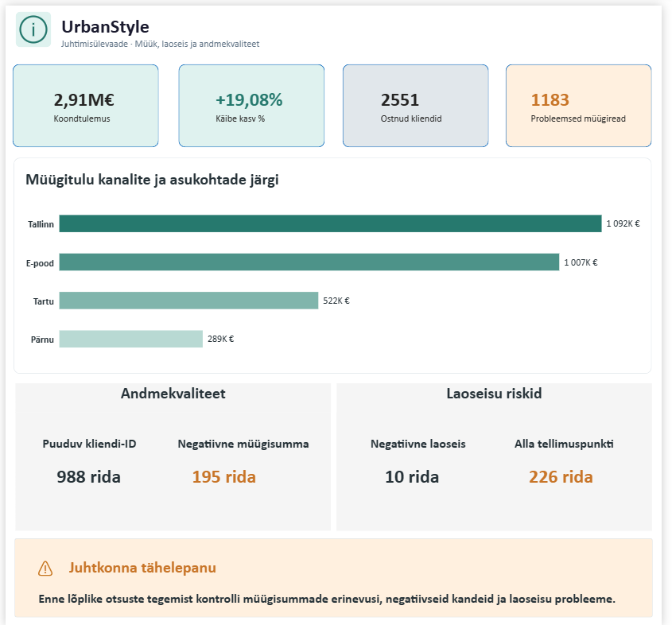
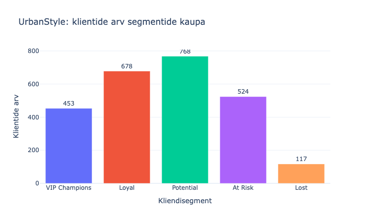

# Andres Assuküll
### 📊 Data Analytics Portfolio

**SQL · Python · Data Quality · Business Intelligence · Automation**

*Andmetest usaldusväärsete järelduste ja praktiliste otsusteni.*

  

<a href="https://github.com/andres-assukyll/urbanstyle-sales-analytics">🤝 Meeskonnaprojekt</a> &nbsp;·&nbsp;
<a href="https://andres-assukyll.github.io/daca-portfolio/">📈 Interaktiivsed aruanded</a> &nbsp;·&nbsp;
<a href="https://andres-assukyll.github.io/daca-portfolio/week-9/index.html">🧩 Veebitööriistad</a>

---

## 👋 Minust

Arendan oma andmeanalüüsi oskusi **Data Analyst Career Accelerator (DACA)** programmis. Minu portfoolio ühendab SQL-i ja Pythoni põhise andmetöötluse, andmekvaliteedi kontrolli, visualiseerimise ning äriliste järelduste sõnastamise.

Mind huvitab eriti see, **kuidas muuta andmed usaldusväärseks ja otsuste tegemisel kasutatavaks**: leida vastuolud enne aruandlust, mõista klientide käitumist, automatiseerida korduvaid analüüse ning tõlkida tulemused selgeteks soovitusteks. Täiendavad huvivaldkonnad on finants- ja ärianalüüs ning investeeringute analüüs.

> **Portfoolio kontekst:** tegemist on DACA õppe- ja meeskonnaprojektidega, peamiselt UrbanStyle'i näidisettevõtte andmetel. Arvulised tulemused pärinevad projektiandmetest, mitte tegeliku ettevõtte avalikust aruandlusest.

## ✨ Portfoolio lühidalt

| 🔎 Andmekvaliteet | 👥 Kliendianalüüs | ⚙️ Automatiseerimine |
|:---:|:---:|:---:|
| **501** kontrolli vajavat müügirida | **2540** analüüsitud ostnud klienti | **3** perioodiga ETL-demo |
| SQL + Python | RFM + pandas | Python + API + aruanded |

Arvud on eri õppeprojektide dokumenteeritud tulemused; need ei ole üks ja sama andmevalim.

## 🚀 Valitud projektid
### 01 · 🔍 Andmekvaliteedi audit — SQL + Python

**Probleem:** enne müügi- ja juhtimisaruannete koostamist tuli hinnata, kas müügi-, kliendi- ja laoandmed on usaldusväärsed.

**Minu panus:** kontrollisin SQL-is müügitulu, kliendiseoseid ja laoseisu; kasutasin Pythonit müügisummade ristvalideerimiseks ning eristasin uurimist vajavad erinevused võimalikest tavapärastest äritehingutest.

**Dokumenteeritud leiud:** 10 118 müügirida; 988 puuduva `customer_id`-ga rida; 501 rida, mille `total_price` erines arvutusest `quantity × unit_price` rohkem kui 0,01 €; neist 195 negatiivse müügisummaga. Need on **kontrollisignaalid**, mitte automaatselt tõendatud vead — põhjused võivad olla näiteks tagastused või hinnastamisreeglid.

**Tehnoloogiad:** PostgreSQL / Supabase, SQL, Python, pandas, Power BI.

[SQL-audit ja järeldused](week-5/README.md) · [Pythoni ristvalideerimine](week-6/README.md) · [Dashboard](week-6/img/quality_ctrl_dashboard.png) · [Power BI fail](week-6/week6_dashboard_quality.pbix)

---

### 02 · 👥 RFM-kliendisegmentatsioon ja ärisoovitused

**Probleem:** kuidas eristada väärtuslikke, lojaalseid ja kaotamisriskiga kliente ning kujundada sihitud tegevusi?

**Minu panus:** valmistasin müügi- ja kliendiandmed pandas'e abil analüüsiks ette ning koostasin täiendava RFM-segmentatsiooni ja visualiseeringud.

**Dokumenteeritud tulemus:** analüüsis 2540 ostnud klienti ja 8923 positiivset müügikirjet; 524 klienti märgiti segmenti **At Risk**. Soovitasin testida kliendihoiu- ja taasaktiveerimiskampaaniaid ning mõõta mõju kontrollrühmaga. Segmentatsioon kajastab analüüsi ajaloolist viitekuupäeva **28.02.2025**, mitte klientide praegust seisu.

**Tehnoloogiad:** Python, pandas, Jupyter Notebook, visualiseerimine.

[RFM-analüüs ja järeldused](week-7/individual/rfm_analysis.md) · [Andmete ettevalmistus](week-7/individual/week7_rfm_role_A.ipynb) · [Segmenteerimise kood](week-7/individual/week7_rfm_role_A_seg.ipynb) · [Visualiseeringud](week-7/individual/week7_rfm_role_A_vis.ipynb)

---

### 03 · ⚙️ ETL-töövoog ja interaktiivsed aruanded

**Probleem:** korduvat müügiaruandlust on vaja muuta vähem käsitsi tehtavaks ning hõlpsasti jälgitavaks.

**Minu panus:** töötasin Pythoni andmete valideerimise ja transformeerimise mooduliga, lisasin logimisloogikat ning koostasin eraldi lahendusi korduskatsete seadistamiseks, perioodivalikuks ja koondteavitusteks. Projekti **meeskondlik** ETL-lahendus ühendab andmete hankimise, teisendamise, aruandluse ja teavitamise.

**Dokumenteeritud tulemus:** meeskonna demo töötles edukalt jaanuari, märtsi ja mai 2023 ning lõi CSV- ja interaktiivsed HTML-aruanded. Siinses repositooriumis on minu moodulid ja meeskonna demo väljundid; kogu käivitatav pipeline ei asu tervikuna selles kaustas.

**Tehnoloogiad:** Python, pandas, Supabase API, logging, argparse, Plotly.

[Minu transformatsioonikood](week-8/individual/transform.py) · [ETL-demo](week-8/team/week8_pipeline_demo.md) · [Interaktiivne KPI-raport](https://andres-assukyll.github.io/daca-portfolio/kpi_summary_20261007_2023Jan.html) · [Nädalase käibe raport](https://andres-assukyll.github.io/daca-portfolio/weekly_revenue_20261007_2023Jan.html)

---

### 04 · 📈 SQL-põhine müügi- ja kliendianalüüs

**Probleem:** millised kliendid ja müügikanalid annavad suurema osa käibest ning kuidas neid rühmitada?

**Minu panus:** ühendasin müügi- ja kliendiandmeid, analüüsisin ostukäitumist ja müügikanaleid ning kasutasin agregeerimist ja kliendisegmentatsiooni äriliste tähelepanekute sõnastamiseks.

**Dokumenteeritud tulemus:** analüüsis tuvastati 2551 ostnud klienti; Tallinna poe müügimaht oli umbes 1,09 mln € ja e-poel 1,01 mln €. Kliendisegmentide analüüs tõi välja VIP-klientide eripärad ja kliendihoiu küsimused.

**Tehnoloogiad:** SQL, JOIN, GROUP BY, HAVING, CTE, aknafunktsioonid.

[Müügi- ja kliendianalüüs](week-3/README.md) · [Kliendisegmentatsioon](week-4/README.md)

---

### 05 · 🧩 Interaktiivne värbamise tööriistakomplekt

**Probleem:** kuidas muuta kandidaadi pehmete oskuste hindamine struktureeritumaks ja tõenduspõhisemaks?

**Minu panus:** koostasin värbamisjuhendi ning HTML-, CSS- ja JavaScript-põhised tööriistad STAR-intervjuu märkmete ja kompetentsipõhise hindamise jaoks.

**Tulemus:** interaktiivne STAR-vorm ja Hiring Scorecard, mis toetavad hinnete ja põhjenduste talletamist ning tulemuste eksporti. See projekt näitab ka minu võimet kujundada andmeid ja otsuseid toetavaid kasutajaliideseid.

**Tehnoloogiad:** HTML, CSS, JavaScript, struktureeritud hindamismudelid.

[Proovi tööriistu](https://andres-assukyll.github.io/daca-portfolio/week-9/index.html) · [Värbamisjuhend](week-9/individual/pm_full.md) · [Lähtekood](docs/week-9/)

---

## 🛠️ Tööriistad

| Valdkond | Portfoolios dokumenteeritud praktiline kasutus |
|---|---|
| **SQL · PostgreSQL · Supabase** | JOIN-id, agregatsioonid, CTE-d, kvaliteedikontroll ja kliendisegmentatsioon |
| **Python · pandas · Jupyter** | Andmete laadimine, puhastamine, valideerimine, KPI-d ja RFM |
| **Power BI · Plotly** | Andmekvaliteedi dashboard ja interaktiivsed müügiaruanded |
| **API · ETL** | Andmete teisendamine, logimine, perioodivalik, koondteavitused |
| **Git · GitHub · VS Code** | Versioonihaldus, analüüsikood ja dokumentatsioon |
| **HTML · CSS · JavaScript** | Interaktiivsed kandidaatide hindamise tööriistad |

R ja Excel on säilitatud tööriistade ülevaates; selles repositooriumis ei ole nende praktilisi näiteid samaväärselt esile toodud.

## 🧭 Kust alustada?

**5 minutit:** [andmekvaliteedi audit](week-6/README.md) ja [RFM-analüüs](week-7/individual/rfm_analysis.md).

**Tehniline süvavaade:** [Pythoni ETL-transformatsioonid](week-8/individual/transform.py), [SQL-päringud](week-4/week4_customer_segmentation_aggregation.sql) ja [meeskonna ETL-demo](week-8/team/week8_pipeline_demo.md).

**Interaktiivsed näited:** [müügiaruanded](https://andres-assukyll.github.io/daca-portfolio/) ja [värbamistööriistad](https://andres-assukyll.github.io/daca-portfolio/week-9/index.html).

Kõik nädalapõhised tööd on leitavad kaustadest [`week-0` kuni `week-9`](https://github.com/andres-assukyll/daca-portfolio). Meeskonna tervikprojekt: [UrbanStyle Sales Analytics](https://github.com/andres-assukyll/urbanstyle-sales-analytics).

---

## 📫 Võta ühendust

  

Data Analyst Career Accelerator (DACA) · 2026 · Õppeprojektid ja meeskonnatööd

<!-- Asenda LinkedIni nupu üldine URL oma päris profiiliaadressiga. -->
