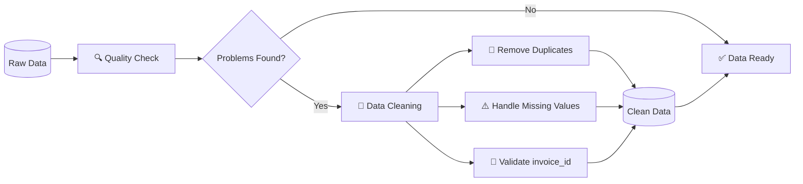

# Nädal 2: SQL Cleaning

> ***Iseseisev töö, kus otsiti puuduvad ja korduvaid andmeid ning uuriti andmeformaate ja tüübikonversioone erinevates andmetabelites.***

---

### 🔄 Andmete puhastamise protsess

---

### 🔍 OSA 1. Duplikaadid ja nende tuvastamine

TABEL: *sales_test*

Leiti **4013** korduvat `sale_id`väärtust. Neist enim korratud, **6** korda, olid `sale_id`**2706** ja **4256**.  
Uuriti korduste rahalist kogumõju ja saadi, et vahe on ca **66%**.

[SQL päring: duplikaadid](./w2_duplicates_query.sql)

Leiti **509** korduvat e-posti aadressi, mis on tekkinud erineva ees- ja/või perenime teisendi tõttu.

[SQL päring: korduvad e-mailid](./w2_emails_query.sql)

---

### ⚠️ OSA 2. NULL väärtused

TABEL: *customers_test*

Leiti **1487** tellimust, kus klient on teadmata. Samuti leiti **2770** klienti, kelle e-posti aadress on teada.  
Lisaks asendati puuduv klientide e-posti aadress vaikeväärtusega **puudub@urbanstyle.ee**.

TABEL: *products_test*

Muudeti 0-hinnaga tooted NULL-iks.

[SQL koondpäring](w2_NULL_query.sql)

---

### 🔄 OSA 3. Andmeformaadid ja tüübikonversioonid

TABEL: *sales_test* : vormindati kuupäevad.  
TABEL: *customers_test* : leiti linnanimede teisendid ja koostati SQL päring nende ühtlustamiseks.

| linn       | kliente | teisendeid |
| ---------- | -------: | :--------: |
| Tallinn    | 1238    | 5          |
| Tartu      | 658     | 5          |
| Pärnu      | 346     | 5          |
| Narva      | 177     | 4          |
| Viljandi   | 112     | 5          |
| Rakvere    | 107     | 5          |
| Kuressaare | 98      | 5          |
| Valga      | 94      | 2          |
| Haapsalu   | 90      | 4          |
| Jõhvi      | 83      | 4          |
| Võru       | 81      | 5          |
| Paide      | 66      | 5          |

[SQL koondpäring](w2_formats_query.sql)
