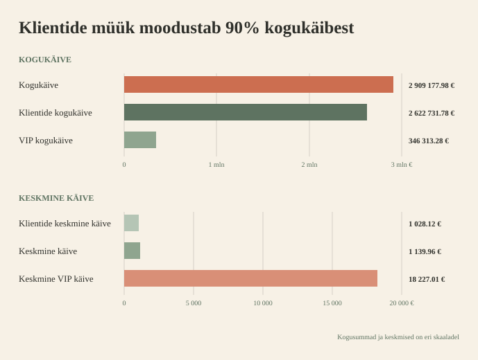
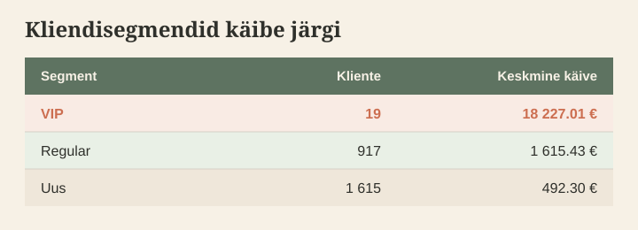
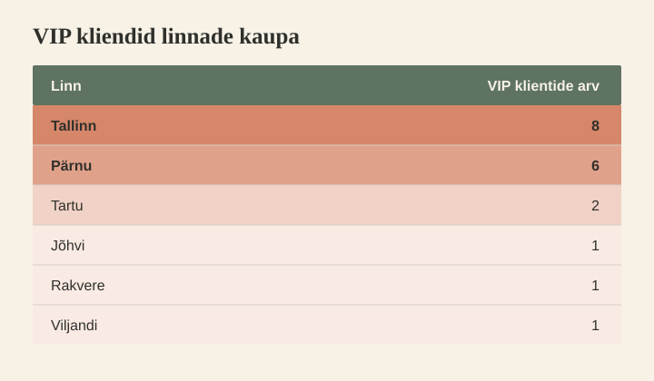
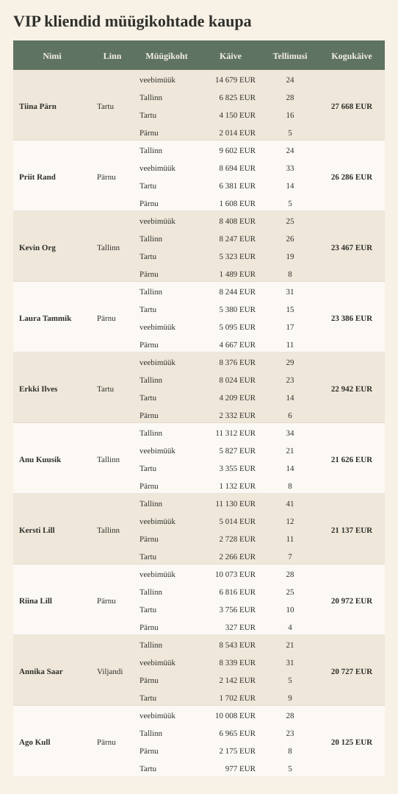

# Sales + Customers — Week 4

**Meeskond:** Sales Analytics  
**Roll:** B – Kliendigruppide analüüs  
**Link grupitööle:** [Sales Analytics](https://github.com/andres-assukyll/urbanstyle-sales-analytics/blob/main/week4/README.md)

---

## 🎯 Eesmärk

> Segmenteerida kliendid kulutuse järgi `VIP` · `Regular` · `Uus`.  
Leida TOP kliendid ja koostada kliendiprofiili kokkuvõte Annale.

Tõõs kasutatud päringud:
- [Põhipäringud](./week4_customer_segmentation_aggregation.sql)
- [Lisapäringud](./week4_customer_segmentation_aggregation_add.sql)
  
---

# 🏆 TOP 10

### LISATULEMUSED

#### Segmendid klientide asukoha järgi

| Linn    | VIP-kliente | Tavakliente | Uusi kliente | Linna kogukäive | TOP klient linnas |
| ------- | ----------- | --------------- | ------------ | --------------- | ---------------- |
| Tallinn | 8           | 358             | 641          | 1 006 253 EUR   | Kevin Org        |
| Tartu   | 2           | 190             | 333          | 523 287 EUR     | Tiina Pärn       |
| Pärnu   | 6           | 102             | 168          | 374 006 EUR     | Priit Rand       |

#### VIP-klientide lojaalsusaste

| Nimi         | Lojaalsusaste |
| ------------ | ------------- |
| Annika Saar  | gold          |
| Kevin Org    | gold          |
| Tiina Pärn   | gold          |
| Urmas Kask   | gold          |
| Erkki Ilves  | silver        |
| Laura Tammik | silver        |
| Merike Vaher | silver        |
| Priit Rand   | silver        |
| Ago Kull     | bronze        |
| Marika Sepp  | bronze        |
| Ago Lõoke    | puudub        |
| Ants Paju    | puudub        |
| Anu Kuusik   | puudub        |
| Kersti Lill  | puudub        |
| Pille Sepp   | puudub        |
| Priit Järv   | puudub        |
| Riina Lill   | puudub        |
| Terje Kukk   | puudub        |
| Tiina Laas   | puudub        |

### Klientide keskmine ostukorv ja -sagedus

| Segment | Kliente | Tellimusi | Keskmine ostukorv | Keskmine ostusagedus |
| ------- | ------------- | -------------- | ----------------- | -------------------- |
| VIP     | 19            | 1138           | 304.32 EUR        | 59.89                |
| Regular | 917           | 4138           | 357.99 EUR        | 4.51                 |
| Uus     | 1615          | 3854           | 206.30 EUR        | 2.39                 |

### Allahindluste osakaal

| Segment | Ostud kokku | Hinnangulised kampaaniaostud | Kampaaniaostude osakaal |
| ------- | ---------- | ---------------------------- | ----------------------- |
| VIP     | 1138       | 24                           | 2.1 %                   |
| Regular | 4138       | 68                           | 1.6 %                   |
| Uus     | 3854       | 169                          | 4.4 %                   |

### Lahkumispotentsiaaliga kliendid

| Lahkujaid kokku | VIP lahkujad | Tavaklientidest lahkujad |
| ------------------- | ------------ | ---------------- |
| 926                 | 16           | 910              |

---

#### **🤖 Kasutamine ✨**
> *Kasutasin ChatGPT abi svg-failide kiiremaks genereerimiseks GitHub-i*.  
> *Samuti CTE-päringute parandamiseks*.

