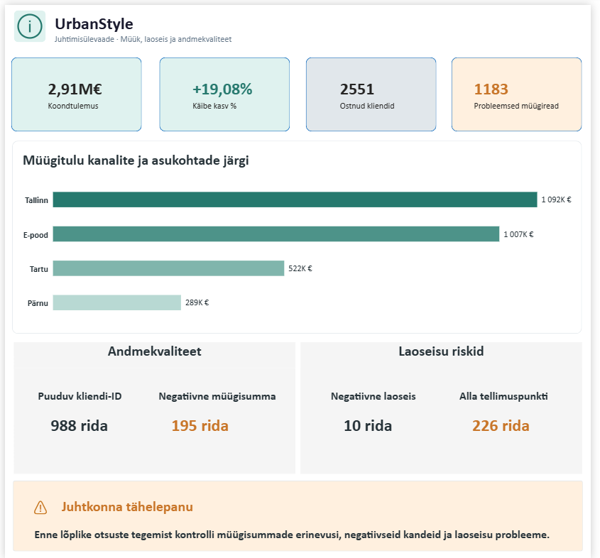

# Visual Design & Python — Week 6

**Meeskond:** Sales Analytics  
**Roll:** E+F – Valideerija & Kvaliteedikontroll + Ärisünteesi koondaja  
**Link grupitööle:** [Sales Analytics](https://github.com/andres-assukyll/urbanstyle-sales-analytics/blob/main/week6/README.md)

## 🎯 Eesmärk

Teha meeskonna töö **usaldusväärseks** ja **tervikuks**. Enne kui tulemus
stakeholderini jõuab, peab kontrollima, et numbrid klapiksid ja lugu oleks ühtne.

**Ülesanne**: Rollide A–D väljundid.

---

## 📋 Kvaliteedikontroll

### Kontrollis kasutatud Python päringud

[Andmete valideerimine](src/week6_validate_data.py)  
[Positiivsed müügid](src/week6_positive_sales_check.py)  
[Ristvalideerimine](src/week6_cross_validation.py)

### Peamised leiud

#### Müügisummade vastuolud

Müügisummade kontrollimisel võrreldi väärtust `total_price` arvutusega `quantity × unit_price`.

- Kokku tuvastati 501 müügirida, mille summa erines arvutuslikust tulemusest rohkem kui 0,01 €.
- Neist 195 real oli müügisumma negatiivne ning 306 real positiivne.
- Positiivse summaga vastuoludest 145 real oli salvestatud summa arvutuslikust suurem ja 161 real väiksem.
- Positiivse summaga vastuolusid esines 201 füüsilise poe müügireal ja 105 veebimüügi real.
- Suurim tuvastatud positiivse summa erinevus oli 386,15 €.

Vastuolud võivad tuleneda andmesisestuse vigadest, allahindlustest, maksudest või teistsugusest hinnastamisloogikast. Enne andmete parandamist tuleb kontrollida tehingute ärireegleid.

#### Puuduvad kliendiandmed

Puuduvate kliendi-ID-dega müüke oli 988 ehk ligikaudu 9,8% kõigist müügiridadest. Nende müügitulu oli kokku 286 446,20 €.

Puuduvate kliendi-ID-dega müügid koondusid 2023.–2024. aastasse: 2023. aastal oli neid 422 ja 2024. aastal 494. Kokku moodustavad need 916 rida ehk ligikaudu 92,7% kõigist puuduva kliendi-ID-ga müükidest.

See muster võib viidata ajalooliste andmete impordi või kliendiandmete sidumise probleemile, kuid põhjus pole veel tõestatud.

#### Muud tähelepanekud

- Kontrollitud ID-veergudes duplikaate ei leitud.
- Puuduvaid tooteviiteid ega puuduvaid müügikuupäevi ei tuvastatud.
- Negatiivse koguse või ühikuhinnaga müügiridu ei leitud.
- Veebimüügi ridadel puuduv `store_location` näib olevat kooskõlas müügikanali loogikaga ega pruugi olla andmekvaliteedi viga.

#### Soovitatavad järgmised sammud

1. Kontrollida positiivse summaga vastuolulisi müügiridu algdokumentide ja hinnastamisreeglite põhjal.
2. Selgitada välja, kas negatiivsed summad tähistavad tagastusi või kreeditarveid.
3. Uurida puuduva kliendi-ID-de põhjuseid, eriti 2023.–2024. aasta andmetes.
4. Kontrollida kümmet toodet, mille jaehind on omahinnast madalam.
5. Lisada automaatsed andmekvaliteedi kontrollid enne edasist müügi- ja kasumlikkuse analüüsi.

### Kokkuvõte

Andmestikus ei leitud kontrollitud ID-veergudes duplikaate ega puuduvaid tooteviiteid. Peamised uurimist vajavad probleemid on puuduvad kliendi-ID-d, müügisummade arvutuslikud vastuolud ja kümme toodet, mille jaehind on omahinnast madalam.

## 💡 Äriline soovitus Annale
Keskenduda müügiandmete kvaliteedi parandamisele. Esmalt tuleks uurida 988 puuduva kliendi-ID põhjust ja kontrollida 501 müügirea summade erinevusi. Lisaks tuleks üle vaadata 10 toodet, mille jaehind on omahinnast madalam.

**Eesmärk**: tagada usaldusväärsed müügi- ja kasumlikkuse analüüsid ning teha andmetel põhinevaid ärilisi otsuseid.

#### 🤖 Kasutamine ✨
> DAX ...
