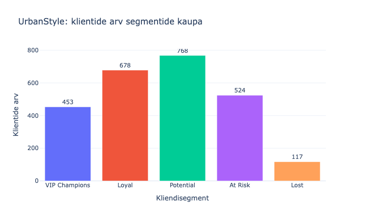
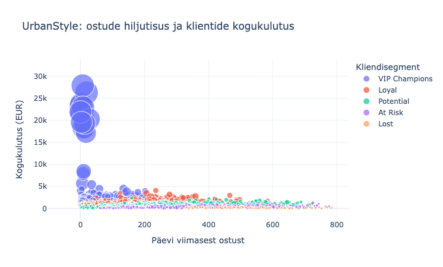
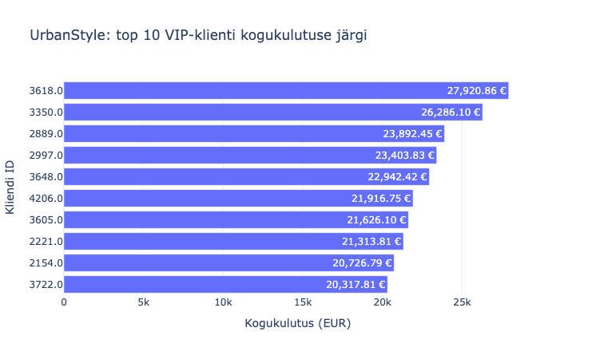

## 📊 RMF-analüüsi tulemused

### 🗂️ Klientide jaotamine

2540 unikaalset klienti jaotati ostude hiljutisuse, sageduse ja rahalise väärtuse põhjal viide ligikaudu võrdse suurusega segmenti. Edasiseks visualiseerimiseks koostati täiendavalt lisaks ka RFM-andmeid sisaldav CSV-fail.

### 🎨 Visualiseerimine

  
  

### 💡 Soovitused

✨ **VIP programm**: paku klientidele varajast ligipääsu uutele kollektsioonidele ja tasuta tarnet alates kindlast ostusummast. Testi programmi 60 päeva ning mõõda kordusostumäära ja kasumit kliendi kohta.

🔄 **Win-back kampaania**: saada At Risk klientidele personaalne pakkumine, näiteks 10% soodustus kehtivusega 14 päeva, ja üks meeldetuletus 7. päeval. Võrdle 30 päeva ostumäära kampaaniat mitte saanud kontrollrühmaga ning kontrolli, kas lisamüük katab soodustuse kulu.

🌱 **Nurture programm**: suuna hiljutised ühe ostuga kliendid tervitussarja: pärast ostu kasutusnõuanded ja 14 päeva pärast sobivate toodete soovitused. Mõõda, kui paljud teevad 30 päeva jooksul teise ostu; uue kliendi staatust kinnita täieliku ostuajaloo põhjal.
Enne kampaaniate käivitamist värskenda RFM-segmendid, sest praeguse analüüsi viitekuupäev on 28.02.2025.

